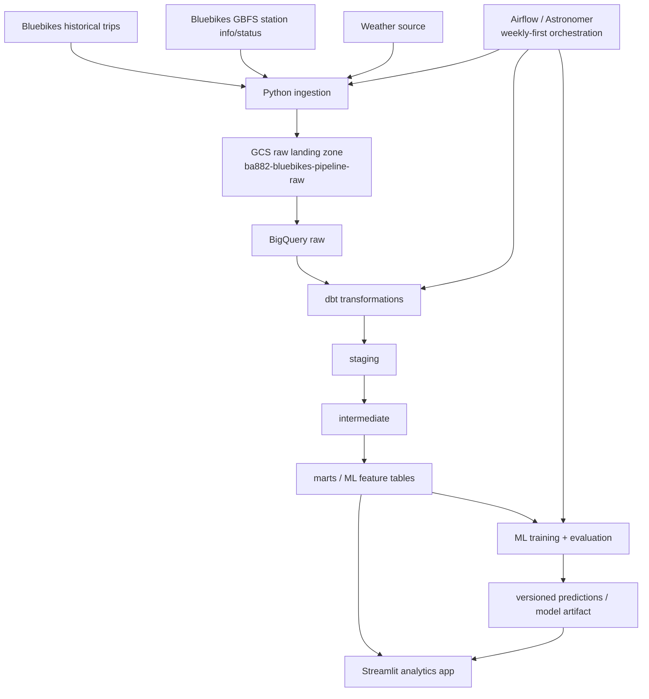

# MVP Architecture and Success Criteria

## Business problem

Bluebikes riders can see current station inventory, but they cannot reliably answer a future-planning question such as:

> "If I want to ride from Brighton Center tomorrow at 2 PM, how likely is it that a bike will be available?"

The project will build a cloud analytics pipeline that combines Bluebikes historical trip data, GBFS station metadata/status snapshots, and weather data to produce station-level availability or shortage-risk forecasts. A secondary operations use case is identifying stations that may require rebalancing.

## Intended users

- **Primary:** Bluebikes riders planning a future trip.
- **Secondary:** Bluebikes operations/rebalancing teams.
- **Internal:** The project team, which needs a reproducible pipeline for ingestion, transformation, model training, evaluation, and deployment.

## MVP scope

The five-week MVP will:

1. Ingest Bluebikes historical trips, GBFS station information/status, and weather data.
2. Preserve source-faithful raw data in GCS.
3. Load data into BigQuery and transform it with dbt through raw/staging/intermediate/marts layers.
4. Orchestrate the pipeline with Airflow/Astronomer.
5. Train and evaluate a reproducible baseline and candidate ML model.
6. Expose forecasts and supporting analytics in a Streamlit-style application/API.
7. Run the source refresh and model workflow **weekly first**, with higher-frequency ingestion treated as a stretch goal.

### Important cadence limitation

A weekly station-status snapshot does **not** provide enough intraday inventory observations to claim real-time or high-confidence next-day availability prediction. Therefore:

- the infrastructure MVP will operate on a weekly refresh;
- the desired availability target remains the long-term model target;
- if the team does not collect enough station-status history, the first deployed model will be explicitly labeled as a **demand/shortage-risk proxy**, not a true real-time inventory forecast;
- increasing GBFS station-status collection cadence is a stretch goal once the weekly pipeline is stable.

## Stretch goals

- Increase GBFS snapshot cadence from weekly to daily or sub-daily.
- Predict both bike availability at origin and dock availability at destination.
- Recommend nearby alternative stations.
- Add automated model retraining/promotion in MLflow.
- Add station shortage/rebalancing views for operations.
- Add a bounded GenAI explanation layer over structured model output.
- Add infrastructure-as-code and stricter IAM/service-account separation.

## Architecture



## Cloud boundary

Current shared GCP foundation:

- **GCP project:** `ba882-bluebikes-pipeline`
- **Raw GCS bucket:** `ba882-bluebikes-pipeline-raw`
- **GCS region:** `us-east1`
- **BigQuery datasets:** `raw`, `staging`, `intermediate`, `marts`, `ml`
- **Budget alert:** $100 project budget
- **Development authentication:** individual team Google identities for the MVP; service accounts/IAM hardening are deferred until deployment if needed.

## Data contracts and modeling layers

### Raw

Source-faithful records plus ingestion metadata. Raw data should be replayable and auditable.

Expected entities:

- `raw_station_information`
- `raw_station_status`
- `raw_trips`
- `raw_weather`

### Staging

dbt models standardize names, types, timestamps, station identifiers, units, and deduplication.

### Intermediate

Reusable business logic such as:

- station-hour trip flows;
- arrivals/departures/net flow;
- weather alignment;
- lag/rolling features;
- observed station inventory history when sufficient snapshots exist.

### Marts

Consumer-ready models such as:

- `dim_station`
- `dim_date`
- `fct_station_hourly_flow`
- `fct_station_status`
- `mart_station_availability_features`

## Prediction definition

### Desired production target

For station (s) and requested future timestamp (t):

```text
target_has_bike = 1 if num_bikes_available >= 1
                  0 otherwise
```

Primary output:

```text
P(target_has_bike = 1 | station, requested time, weather, historical behavior, available lag features)
```

### Forecast horizon

The initial product question is **up to 24 hours ahead**, with "tomorrow at 2 PM" as the representative use case.

If snapshot coverage is insufficient for a defensible 24-hour availability classifier, the team will deploy a clearly labeled shortage-risk/demand proxy for the MVP and preserve the true availability target as the next iteration.

### Baselines

At minimum, compare the candidate model against:

1. **Seasonal historical baseline:** station × hour-of-day × day-of-week historical probability or demand average.
2. **Simple statistical baseline:** logistic regression for the binary availability target, or a linear/count baseline for the proxy target.

A tree-based model such as XGBoost may be used as the candidate model after the baselines are established.

## Evaluation metrics

For the true binary availability target:

- Brier score / probability calibration;
- ROC-AUC;
- precision and recall for shortage events;
- calibration curve;
- performance by station and forecast horizon.

For a demand/shortage-risk proxy:

- MAE/RMSE for predicted departures or net flow;
- precision/recall for high-risk station-hours.

### Model success criterion

The candidate model must outperform the agreed seasonal baseline on the primary held-out chronological metric. A model is not considered successful merely because it is more complex.

## MVP success criteria

### Data pipeline

- Weekly scheduled workflow completes end-to-end without manual data editing.
- Re-running the same ingestion period is idempotent or safely deduplicated.
- Raw data retains source and ingestion timestamps.
- Pipeline failures are visible in Airflow/Astronomer logs.

### Warehouse and data quality

- dbt builds source → staging → intermediate → marts successfully.
- Primary identifiers/timestamps satisfy not-null and uniqueness expectations where applicable.
- Station relationships are validated.
- Invalid or impossible bike/dock counts are detected.
- The ML feature mart is point-in-time safe and documents any unavailable features.

### ML

- Chronological train/validation/test split is used.
- Candidate model is compared with a simple baseline.
- Model output is reproducible from versioned code and data references.
- Probabilistic predictions are calibrated/evaluated rather than judged on accuracy alone.
- Product copy clearly distinguishes a true availability forecast from a proxy if snapshot coverage is insufficient.

### Product

- A user can select a station and future time.
- The interface shows the forecast/risk plus the timestamp and freshness of the underlying data.
- Observed values are visually distinguished from predicted values.
- Missing/stale data and unavailable predictions fail gracefully.

### Operations

- Source refresh, dbt build, and model workflow are orchestrated weekly for the MVP.
- GCP spend remains within the project's $100 budget alert.
- Secrets/credentials are never committed to GitHub.
- Repository work is performed through issues/branches/PRs with review before merge.

## Source and licensing assumptions

- Bluebikes historical trip data and GBFS feeds are treated as the authoritative project sources for trip and station information. Exact endpoint/version/schema details and current reuse terms must be verified and recorded by ING-01/ING-02 before production ingestion.
- Historical trip records represent completed trips; they do **not** reconstruct exact historical station inventory by themselves.
- A weather provider has not yet been finalized. ING-03 must verify provider terms, geographic coverage, rate limits, cost, and whether historical observations and forecasts are available.
- Raw source payloads will be preserved with provenance to support auditing and reprocessing.

## Cost constraints

- Shared GCP project budget alert: **$100**.
- Prefer BigQuery, GCS, Astronomer/course resources, and lightweight application hosting.
- Avoid unnecessary always-on compute, Cloud Composer, Dataflow, Kubernetes, or other high-cost managed infrastructure during the MVP.
- Weekly-first refresh is partly a scope/reliability decision and should also keep API/storage/compute usage modest.

## Technical risks

| Risk | Impact | Mitigation |
| --- | --- | --- |
| Weekly GBFS snapshots are too sparse for true availability forecasting | High | Label first model as a proxy unless sufficient snapshots are collected; increase cadence as a stretch goal |
| Historical trip data records completed rides, not unmet demand | High | Use station-status observations as the eventual ground truth and document censoring |
| Station IDs/names/capacity may change | Medium | Maintain a station dimension and source lineage |
| Weather timestamps can leak future information | High | Use point-in-time joins based on forecast issue time/availability |
| Schema changes or missing source files | Medium | Validate schemas, log failures, preserve raw payloads |
| Team members create incompatible pipeline interfaces | Medium | Define table/model contracts and require PR review |
| Cloud spend grows unexpectedly | Medium | $100 budget alert, partition BigQuery tables, avoid always-on compute |
| Limited five-week timeline | High | Weekly-first MVP, feature freeze before final week, stretch goals remain optional |

## Responsibility areas

The architecture defines five responsibility areas without coupling the design to any individual teammate:

1. **Technical integration and DevOps** — architecture, GitHub workflow, cloud integration, deployment, reliability.
2. **Data ingestion and orchestration** — source APIs/files, GCS landing, Airflow/Astronomer, retries and schedules.
3. **Analytics engineering and data modeling** — BigQuery, dbt, warehouse layers, tests, lineage.
4. **ML engineering and MLOps** — feature contract, baselines, candidate model, evaluation, experiment tracking, inference.
5. **Data product and analytics** — Streamlit/BI, UX, stakeholder-facing analytics, optional GenAI explanation layer.

## Architecture decision

For the first implementation increment, the team will prioritize a **working, reproducible weekly end-to-end pipeline** over high-frequency collection. The architecture intentionally leaves the ingestion cadence configurable so that daily/sub-daily GBFS collection can be introduced later without redesigning the warehouse, model contract, or application.
