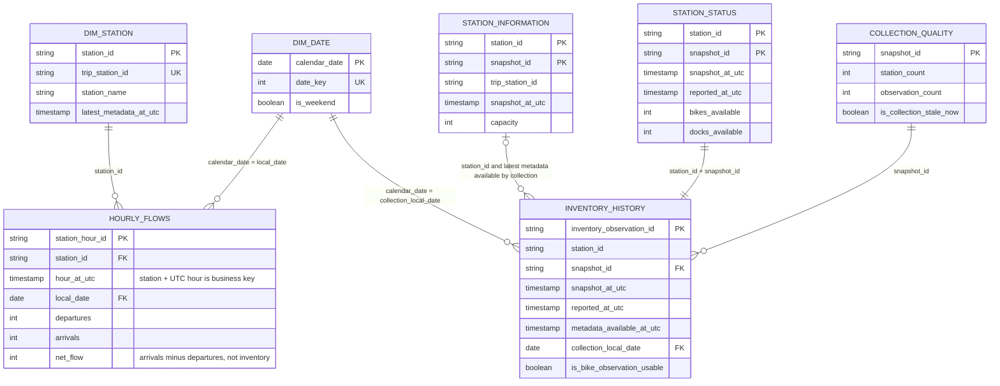
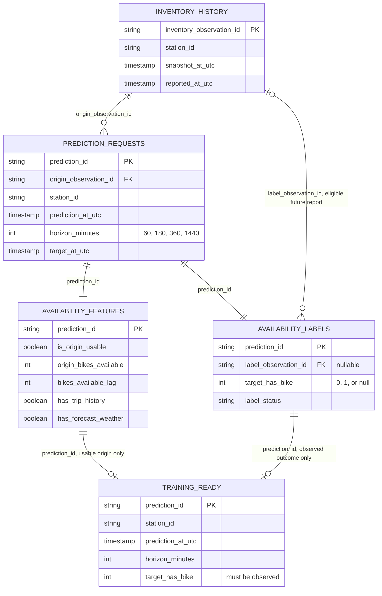
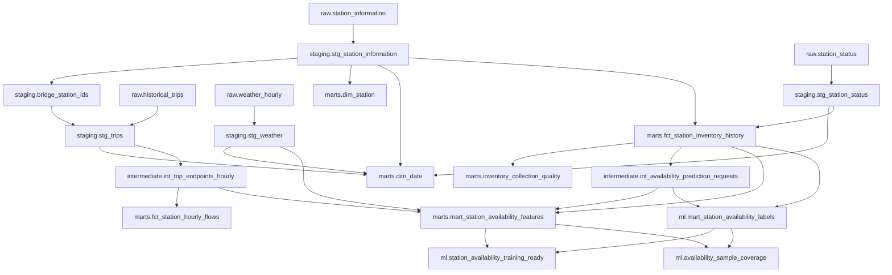

# Implemented warehouse data model

Verified against the SQL and YAML on `main` on 2026-10-25. Project: `ba882-bluebikes-pipeline`; all BigQuery datasets use `US`. This describes implemented relations, not a trained forecasting model.

**Grain** means what one row represents. **PK** labels the tested logical unique key, not an enforced BigQuery primary-key constraint. **FK** labels a join reference; unmapped stations and unavailable outcomes can be null. IDs are strings and UTC timestamps identify event hours; Boston local timestamps are display/calendar attributes.

## 1. Analytics relationships

The inventory-to-quality connection is aggregation: many observations belong to one collection summary. Information/status snapshot IDs are collection identifiers generated separately for each feed; **do not equijoin the two feeds on snapshot_id**. Inventory metadata is selected as-of the status collection using station ID and timestamp. `dim_station` is latest-known metadata, not a historical station dimension; inventory training uses the as-of metadata instead.

## 2. Prediction requests, features and outcomes

A request exists for every observed station collection crossed with each configured horizon. Features use only information available by the prediction origin. The label is the earliest usable source report in `[target, target + 15 minutes]`; no candidate means null, not zero. A label row can exist without an observed outcome. A training row requires both a usable origin and an observed label. No future label provenance is used as a predictor.

## 3. Source-to-model lineage

Arrows below are dbt dependencies, not proof that the transformation is scheduled in Astro. `raw` has four source tables; the other boxes are the 16 dbt models.

The trip bridge maps provider trip short codes to canonical GBFS station IDs. Trips do not join GBFS directly on their raw station-code fields. Unknown/missing endpoint mappings remain visible upstream; the mapped hourly flow fact excludes unmapped endpoints. Hourly flow rows are sparse observed event hours, not a complete zero-filled station/hour grid.

## 4. Table/view grains and keys

| Dataset.relation | One row represents | Logical unique key |
| --- | --- | --- |
| raw.station_information | One station in one metadata collection | station_id + snapshot_id |
| raw.station_status | One station in one status collection | station_id + snapshot_id |
| raw.historical_trips | One currently loaded ride, with source lineage | ride_id |
| raw.weather_hourly | One weather valid hour, source and forecast-fetch version | weather_time + source + forecast_issued_at; legacy/historical fetch time may be null |
| staging.stg_station_information | One normalized station metadata observation | station_id + snapshot_id |
| staging.stg_station_status | One normalized station inventory observation | station_id + snapshot_id |
| staging.bridge_station_ids | One latest-known canonical station/trip-code mapping | station_id; trip_station_id also unique |
| staging.stg_trips | One normalized ride with nullable mapped endpoints | ride_id |
| staging.stg_weather | One weather valid hour/source/fetch version | weather_record_id |
| marts.dim_station | One latest-known GBFS station | station_id |
| marts.dim_date | One Boston calendar date | calendar_date; date_key also unique |
| intermediate.int_trip_endpoints_hourly | One UTC hour, endpoint type, canonical/raw station IDs and mapping status | endpoint_hour_id |
| marts.fct_station_hourly_flows | One mapped station and observed UTC event hour | station_hour_id; business key station_id + hour_at_utc |
| marts.fct_station_inventory_history | One station/status collection with as-of metadata and quality | inventory_observation_id; business key station_id + snapshot_id |
| marts.inventory_collection_quality | One status collection summary | snapshot_id |
| intermediate.int_availability_prediction_requests | One inventory origin and prediction horizon | prediction_id; business key origin_observation_id + horizon_minutes |
| marts.mart_station_availability_features | One prediction request with as-of predictors and coverage flags | prediction_id |
| ml.mart_station_availability_labels | One prediction request and nullable future outcome | prediction_id |
| ml.station_availability_training_ready | One usable, labelled request with an explicit predictor allowlist | prediction_id |
| ml.availability_sample_coverage | One configured horizon's coverage summary | horizon_minutes |

## Presentation boundaries

- Trip raw timestamps preserve the original unzoned CSV clock; staging applies the documented inferred Boston timezone. Do not silently reinterpret raw values as already-normalized UTC.
- Forecast fetch/warehouse availability times gate prediction features. Raw `forecast_issued_at` means collector fetch time, not confirmed provider issuance time.
- Net trip flow is not inventory change; missing observations or labels are not zero availability.
- A successful build validates software/data contracts, not current freshness, statistically adequate labels or forecasting accuracy.
- Use a dated coverage audit for actual row counts. The old handoff's counts are not a live dashboard.

[Model contracts](../dbt/contracts/README.md) · [Current pipeline status](../pipeline/pipeline-status.md) · [Documentation index](../README.md)
