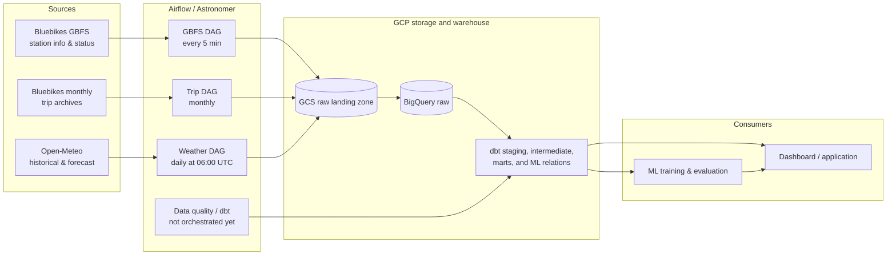
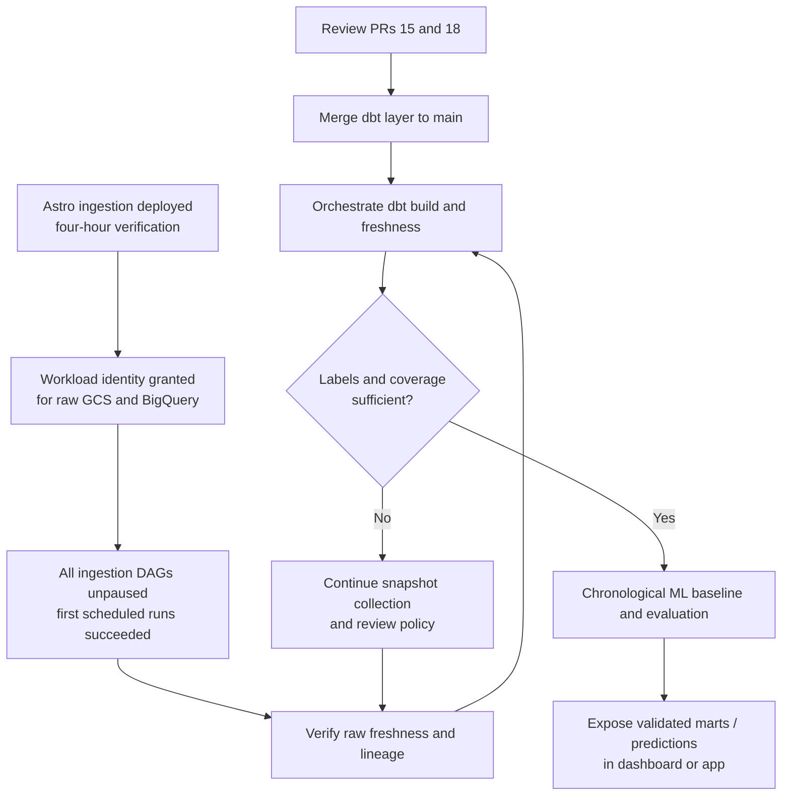

# Pipeline status and integration guide

> **Purpose:** one living view of how the Bluebikes workstreams connect, what is actually running, and what must happen next.
>
> **Last verified:** 2026-10-22 (Eastern Time)  
> **Update this file:** when a PR is merged, an Astro deployment changes, a scheduled run is verified, or a dependency/blocker changes. Do not label a component **Running** based only on local or Cloud Shell validation.

## Status legend

| Status | Meaning |
| --- | --- |
| **Running** | Deployed and observed completing on its intended schedule. |
| **Ready to deploy** | Merged to `main`, but not yet running in the shared Astro deployment. |
| **In review** | Implemented in an open PR; not yet part of `main`. |
| **Blocked** | Cannot safely proceed until the listed dependency is resolved. |
| **Planned** | Designed work that has not started. |

## End-to-end architecture

## Workstream status

| Layer | Current state | Evidence | Dependency / next decision |
| --- | --- | --- | --- |
| Source ingestion | **Running during four-hour verification** | [PR #17](https://github.com/EmperorRP/ba882-bluebikes-availability-pipeline/pull/17) merged and deployed on 2026-10-22; all three DAGs have successful scheduled runs. | Observe additional scheduled intervals; agree the ongoing awake window and budget. |
| Raw data | **Refreshing in cloud** | Eight station-status collections and 5,018 rows were verified at 15:49 UTC, advancing from six collections / 3,762 rows; weather refreshes also succeeded. | Continue monitoring source report times, collection gaps and forecast versions. |
| Astronomer deployment | **Healthy; time-limited verification** | `BA882 Team Project` is healthy with the deployed image and bundle listed below, three unpaused DAGs and no import errors. | Wake override ends 2026-10-22 at 19:43 UTC / 3:43 PM America/New_York. The previous hibernation policy then resumes. |
| dbt / BigQuery modeling | **In review** | [PR #15](https://github.com/EmperorRP/ba882-bluebikes-availability-pipeline/pull/15) is a draft. It reports 16 models built, 134 passing tests, 6 documented warnings, and one passing unit test in Cloud Shell. | Review and merge PR #15; then add `dbt build` and freshness checks to the shared orchestration. |
| Availability labels | **Blocked** | PR #15 reports zero matched real labels and zero training-ready rows for the current 1/3/6/24-hour horizons. | Collect sustained station snapshots; review label tolerance, sampling windows, and horizon policy before ML training. |
| ML | **Planned** | No trained availability model, evaluation, score, or deployment is currently delivered. | Use a chronological split with an embargo for overlapping horizons; compare seasonal/persistence and simple statistical baselines before a candidate model. |
| Analytics app / dashboard | **Planned** | No deployed dashboard or forecast-serving contract is currently delivered. | Start after consumer-ready marts and a clear observed-vs-predicted data contract are available. |

## Current schedules and required changes

The following are **code declarations**, not proof of a running schedule. The DAG timezone must be confirmed in the deployed Airflow environment before communicating local times.

| Workflow | Current schedule | Assessment | Recommended target |
| --- | --- | --- | --- |
| GBFS station snapshots | `*/5 * * * *` UTC | Deployed in PR #17; five-minute collection provides opportunities inside the 15-minute label window despite report lag. | Sustain collection beyond the verification window, subject to the course budget. |
| Weather ingestion | `0 6 * * *` UTC | Deployed in PR #17; daily refresh aligns with the dbt forecast-freshness warning at 36 hours and error at 48 hours. | Separate historical backfills from forecast refresh as a follow-up optimization. |
| Historical trips | `0 6 10 * *` | Monthly source cadence is appropriate, assuming the source archive is available by then. | Keep monthly and add a retry/alert path for delayed source publication. |
| dbt build and freshness | Not in current DAG code | Models can be built manually, but source-to-mart updates are not yet automated. | Run after successful raw loads on an agreed cadence; start daily, plus after monthly trips. |
| ML retraining | Not implemented | Training is premature while labels are absent. | Weekly only after coverage thresholds and split policy are approved. |

## Integration sequence

## Operational checks

### Before calling the pipeline deployed

- [ ] An ongoing awake policy supports every intended run after the four-hour test window.
- [x] The `main` DAG bundle has a deployed version matching the reviewed code merged to `main`.
- [x] The Astro workload identity has scoped ingestion access to the raw GCS bucket and BigQuery dataset.
- [x] All three ingestion DAGs appear in Airflow, are unpaused, and have at least one successful scheduled run.
- [x] Advancing raw ingestion and source-report timestamps were verified in BigQuery.
- [ ] Failure notifications reach the team-owned address/channel, not only an individual or instructor address.

### Before ML training

- [ ] PR #15 is merged and `dbt build` / `dbt source freshness` run in the shared pipeline.
- [ ] Station snapshots span enough continuous time to produce real labels across intended horizons and class balance.
- [ ] Feature/label availability is point-in-time safe; forecast rows are selected by information known at prediction time.
- [ ] The team approves horizons, label tolerance, sampling policy, and chronological train/validation/test split.
- [ ] Baseline metrics and coverage by station and horizon are reported.

## Source documents

- [Architecture and MVP decision](architecture.md)
- [Data sources](data-sources.md)
- [Operations runbook](runbook.md)
- [Ingestion implementation, PR #13](https://github.com/EmperorRP/ba882-bluebikes-availability-pipeline/pull/13)
- [dbt implementation and handoff, PR #15](https://github.com/EmperorRP/ba882-bluebikes-availability-pipeline/pull/15)

## Deployment readiness update — 2026-10-22

Live BigQuery checks confirmed 3,762 raw station-status rows across six collections, latest `2026-10-20 01:51:09 UTC`, and zero labelled/training-ready rows at each horizon. Astro remained hibernating. The inspected project, raw dataset and raw bucket policies did not grant its workload identity ingestion access.

PR #17 implemented five-minute GBFS collection, daily weather at 06:00 UTC, explicit UTC DAG starts, ingestion paths independent of Airflow 3 DAG bundles, interval-based monthly trip selection and real-runtime CI tests. It also pinned the OpenTelemetry API to the runtime-compatible version after CI reproduced an Airflow import failure with unconstrained Google dependencies. Five-minute polling addresses a concrete mismatch: a source report just before a target is excluded, while the next half-hour report can fall beyond the 15-minute label window.

See [runbook](runbook.md) for local authentication, scoped ingestion identity permissions, validation/deployment commands and acceptance checks. PR #15 remains a draft dependency for automated dbt builds. Current collection and coverage checks must be repeated after deployment.

### Deployment and warehouse evidence

- Merged code: `81d7f0cac392a7a812e700fb9c9d0c2fc16b9c10` (PR #17).
- Image tag: `deploy-2026-10-22T15-45-18`; digest `sha256:53dca7ec83cec0decb7eb11585e2857da4401736ce2930c06bf835fd0ac06f8d`.
- DAG bundle: `2026-10-22T15:46:36.8286228Z`; deployment became healthy and all three DAGs parsed without import errors.
- Scheduled GBFS run `scheduled__2026-10-22T15:45:00+00:00` succeeded at `15:49:12 UTC`.
- Scheduled weather run `scheduled__2026-10-22T06:00:00+00:00` succeeded at `15:49:13 UTC`.
- Scheduled trip run `scheduled__2026-10-10T06:00:00+00:00` succeeded at `15:49:29 UTC`, exercising the existing September archive through the deployed task. No additional duplicate manual trip run was created.
- Manual verification runs for GBFS and weather also succeeded. Raw station-status audit then showed eight collections / 5,018 rows, latest collection `15:49:28 UTC` and latest source report `15:48:09 UTC`.
- Workload identity grants: BigQuery Job User on the project, Data Editor on `raw`, and Storage Object Creator on the raw bucket. Existing grants were preserved; no service-account key was created.
- After the cloud runs, `dbt source freshness` passed for station information, station status and forecast weather at approximately `15:50:14 UTC`. Trips still have no agreed freshness SLA and are excluded from that three-source check. Forecast fetch/ingestion times advanced to `15:49:23 UTC` / `15:49:30 UTC`.
- Independent dbt rebuild in isolated `review_rahul_20261022*` datasets reproduced 16 successful models, 134 passing data tests, six documented warnings and one passing expanded SQL unit test. [PR #18](https://github.com/EmperorRP/ba882-bluebikes-availability-pipeline/pull/18) adds that evidence, polling regression fixtures and credential-free dbt parse CI to Marcus's feature branch.

The wake override expires at `2026-10-22T19:43:08Z` (3:43 PM EDT); it has not been extended. This verifies deployed ingestion during a bounded window, not a semester-long operating schedule. `architecture.md` retains the original weekly-first proposal; the collection cadence above is the tested refinement, with an ongoing budget/awake policy still to be agreed. Shared dbt marts are not yet refreshed automatically, and training remains blocked by coverage and ML policy review.

## Change log

| Date | Change |
| --- | --- |
| 2026-10-22 | Created the integration guide. Recorded merged ingestion code, draft dbt layer, and verified Astro deployment gap. |
| 2026-10-22 | Merged/deployed PR #17 for the approved four-hour window; verified all ingestion DAGs and advancing raw data. Independently reproduced the dbt build and opened regression/CI follow-up PR #18. |
