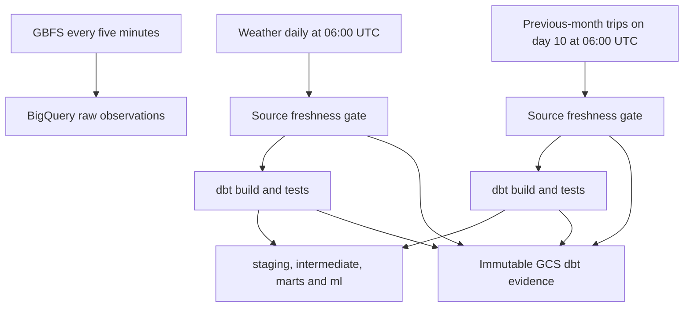

# Automated raw-to-mart transformations

## Workflow and cadence



The two downstream task chains are implemented in the existing weather and trip DAGs. They run only after their ingestion task succeeds and all three configured source-freshness checks pass or warn. An error blocks the build; tests and warnings are not disabled. Trips do not have an agreed freshness SLA and are not part of that three-source check.

Station snapshots remain every five minutes, but the warehouse is not rebuilt every five minutes. Daily weather refresh triggers the regular build; monthly trip refresh triggers an additional build. Consequently, derived inventory/features are a daily analytical snapshot, not a live serving layer. Both paths use the one-slot `bluebikes_dbt_build` Airflow pool, so their dbt commands cannot overlap even when both are scheduled on the 10th. They use the existing `dbt` worker queue with minimum worker count zero. Build tasks do not retry an entire warehouse rebuild automatically; investigate a failed build before rerunning it.

These are UTC DAG schedules. Astro must be awake for them to execute. The existing Tuesday-only wake window is incompatible with continuous GBFS and daily forecast freshness. `catchup=False` does not recover station observations missed while asleep; a late scheduler can still create the latest eligible scheduled interval. Always inspect the run's logical interval and actual start/end times.

## Runtime packaging

The canonical dbt code remains in the repository's `dbt` directory. Docker receives that directory as a named build context, rather than a second maintained copy. Its `.dockerignore` excludes real profiles, credentials-like environment files, logs and generated targets. dbt is installed into its own virtual environment because its dependencies must not replace Airflow's runtime dependencies.

From the repository root:

```powershell
$revision = git rev-parse HEAD
docker build --build-context dbt_project=./dbt --build-arg CODE_REVISION=$revision -t bluebikes-phase1-dbt orchestration/astro
docker run --rm --entrypoint python bluebikes-phase1-dbt -m unittest discover -s /usr/local/airflow/tests -v
docker run --rm --entrypoint python bluebikes-phase1-dbt -m pip check
docker run --rm --entrypoint /usr/local/airflow/dbt-venv/bin/pip bluebikes-phase1-dbt check
docker run --rm --entrypoint /usr/local/airflow/dbt-venv/bin/dbt bluebikes-phase1-dbt parse --project-dir /usr/local/airflow/dbt --profiles-dir /usr/local/airflow/warehouse/profiles --no-partial-parse
```

Use the prebuilt image when deploying from `orchestration/astro`; an ordinary implicit build does not supply the named dbt context:

```powershell
astro deploy cmv1byju444do01pl0bhotk1f --image-name bluebikes-phase1-dbt --wait
```

A DAG-only deploy cannot ship dbt models, the runner or dependencies. Rebuild and deploy the image whenever any of those change. Set `CODE_REVISION` to the reviewed Git commit so evidence can identify its source. Local parse/runtime tests do not access BigQuery or prove cloud IAM.

## Identity, concurrency and query controls

- The production profile uses Application Default Credentials from Astro's existing workload identity, not a checked-in key or a teammate's OAuth credentials.
- BigQuery location: `US`; target staging dataset: `staging`; the checked-in schema macro resolves the shared `intermediate`, `marts` and `ml` datasets.
- The identity has project BigQuery Job User, dataset-scoped write access on `raw`, `staging`, `intermediate`, `marts` and `ml`, and Object Creator on the raw bucket. Existing grants are preserved. No project-wide Editor/Owner or service-account key is needed.
- Create the `bluebikes_dbt_build` pool with one slot before running the new tasks. A missing pool leaves tasks unable to run; verify it in Airflow rather than assuming its presence.
- Two dbt threads; one query retry; 300-second query execution timeout; 1,000,000,000 maximum bytes billed **per query**. These are not a whole-run dollar cap, total billing cap or credit balance.
- The runner has a 30-minute subprocess timeout, and the outer Airflow call has a 1,900-second timeout. Each attempt uses its own temporary target/log directories.

## Evidence and failure behavior

Each freshness/build attempt uploads a minimal JSON summary under `gs://ba882-bluebikes-pipeline-raw/dbt-runs/DATE/UNIQUE_ID/`. It records code revision, DAG/run ID, UTC capture time, command exit code, dbt invocation/version, counts and resource statuses. Freshness results include source max-loaded timestamps. It does not upload credentials, source rows, full logs or the full compiled manifest.

The evidence URI and result counts appear in task logs. Uploads use a create-only precondition and never overwrite prior evidence. Nonzero process exit, timeout, missing results, or failed/error artifact statuses fail the task; documented warnings remain visible without being treated as errors. An evidence-upload failure is also visible as a failed task, not silently discarded.

For the presentation, open weather/trip Graph view, select the actual run, show ingestion -> freshness -> build, then cross-check its GCS summary and BigQuery table modification/coverage results. A historical successful run does not establish current source freshness.

[Operating and budget policy](operating-policy.md) · [Data model](../architecture/data-model.md) · [Runbook](runbook.md)
