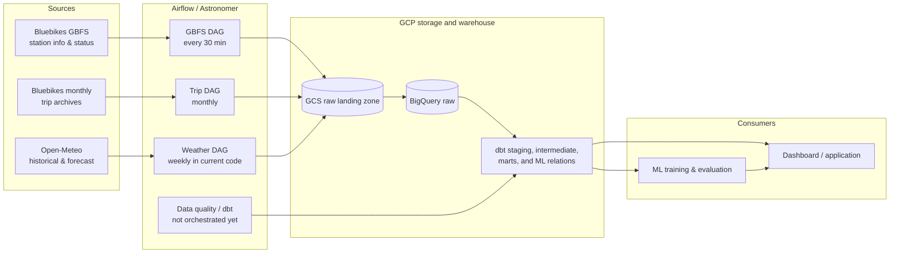
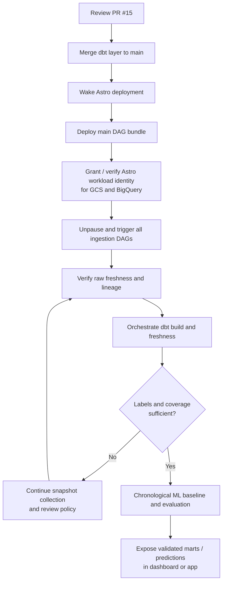

# Pipeline status and integration guide

> **Purpose:** one living view of how the Bluebikes workstreams connect, what is actually running, and what must happen next.
>
> **Last verified:** 2026-10-22 (Eastern Time)  
> **Update this file:** when a PR is merged, an Astro deployment changes, a scheduled run is verified, or a dependency/blocker changes. Do not label a component **Running** based only on local or Cloud Shell validation.

## Status legend

| Status | Meaning |
| --- | --- |
| **Running** | Deployed and observed completing on its intended schedule. |
| **Ready to deploy** | Merged to `main`, but not yet running in the shared Astro deployment. |
| **In review** | Implemented in an open PR; not yet part of `main`. |
| **Blocked** | Cannot safely proceed until the listed dependency is resolved. |
| **Planned** | Designed work that has not started. |

## End-to-end architecture

## Workstream status

| Layer | Current state | Evidence | Dependency / next decision |
| --- | --- | --- | --- |
| Source ingestion | **Ready to deploy** | [PR #13](https://github.com/EmperorRP/ba882-bluebikes-availability-pipeline/pull/13) merged on 2026-10-20; includes GBFS, historical trips, weather, GCS, BigQuery, and three DAG definitions. | Deploy `main` to Astro, then record successful unattended runs. |
| Raw data | **Partially available** | GCS and BigQuery raw datasets/tables exist; historical trips, station data, and weather were loaded during development. | Confirm freshness advances from the deployed schedules, not only local/manual runs. |
| Astronomer deployment | **Blocked** | `BA882 Team Project` exists in `BA882 Team Workspace`, but was hibernating on 2026-10-22. Its `main` DAG bundle had no current or desired version. | Wake deployment, configure the intended hibernation policy, deploy the repository bundle, then verify DAG parsing and runs. |
| dbt / BigQuery modeling | **In review** | [PR #15](https://github.com/EmperorRP/ba882-bluebikes-availability-pipeline/pull/15) is a draft. It reports 16 models built, 134 passing tests, 6 documented warnings, and one passing unit test in Cloud Shell. | Review and merge PR #15; then add `dbt build` and freshness checks to the shared orchestration. |
| Availability labels | **Blocked** | PR #15 reports zero matched real labels and zero training-ready rows for the current 1/3/6/24-hour horizons. | Collect sustained station snapshots; review label tolerance, sampling windows, and horizon policy before ML training. |
| ML | **Planned** | No trained availability model, evaluation, score, or deployment is currently delivered. | Use a chronological split with an embargo for overlapping horizons; compare seasonal/persistence and simple statistical baselines before a candidate model. |
| Analytics app / dashboard | **Planned** | No deployed dashboard or forecast-serving contract is currently delivered. | Start after consumer-ready marts and a clear observed-vs-predicted data contract are available. |

## Current schedules and required changes

The following are **code declarations**, not proof of a running schedule. The DAG timezone must be confirmed in the deployed Airflow environment before communicating local times.

| Workflow | Current schedule | Assessment | Recommended target |
| --- | --- | --- | --- |
| GBFS station snapshots | `*/30 * * * *` | Correct cadence for accumulating inventory observations, but it requires an always-available scheduler. | Keep every 30 minutes while collecting labels; make Astro available continuously. |
| Weather ingestion | `0 6 * * 1` | Weekly refresh conflicts with the dbt forecast-freshness warning at 36 hours and error at 48 hours. | Agree a daily forecast refresh and explicit freshness SLA with ML; retain a separate cadence for historical backfills. |
| Historical trips | `0 6 10 * *` | Monthly source cadence is appropriate, assuming the source archive is available by then. | Keep monthly and add a retry/alert path for delayed source publication. |
| dbt build and freshness | Not in current DAG code | Models can be built manually, but source-to-mart updates are not yet automated. | Run after successful raw loads on an agreed cadence; start daily, plus after monthly trips. |
| ML retraining | Not implemented | Training is premature while labels are absent. | Weekly only after coverage thresholds and split policy are approved. |

## Integration sequence

## Operational checks

### Before calling the pipeline deployed

- [ ] Astro deployment is awake for each scheduled run; hibernation does not suppress the 30-minute GBFS DAG.
- [ ] The `main` DAG bundle has a deployed version matching a commit on `main`.
- [ ] The Astro workload identity has least-privilege read/write access required for the raw GCS bucket and BigQuery datasets.
- [ ] All three ingestion DAGs appear in Airflow, are unpaused, and have at least one successful run.
- [ ] Raw table freshness, row counts, and source/ingestion lineage are recorded.
- [ ] Failure notifications reach the team-owned address/channel, not only an individual or instructor address.

### Before ML training

- [ ] PR #15 is merged and `dbt build` / `dbt source freshness` run in the shared pipeline.
- [ ] Station snapshots span enough continuous time to produce real labels across intended horizons and class balance.
- [ ] Feature/label availability is point-in-time safe; forecast rows are selected by information known at prediction time.
- [ ] The team approves horizons, label tolerance, sampling policy, and chronological train/validation/test split.
- [ ] Baseline metrics and coverage by station and horizon are reported.

## Source documents

- [Architecture and MVP decision](../architecture/README.md)
- [Data sources](../ingestion/data-sources.md)
- [Operations runbook](runbook.md)
- [Ingestion implementation, PR #13](https://github.com/EmperorRP/ba882-bluebikes-availability-pipeline/pull/13)
- [dbt implementation and handoff, PR #15](https://github.com/EmperorRP/ba882-bluebikes-availability-pipeline/pull/15)

## Deployment readiness update — 2026-10-22

Live BigQuery checks confirmed 3,762 raw station-status rows across six collections, latest `2026-10-20 01:51:09 UTC`, and zero labelled/training-ready rows at each horizon. Astro remained hibernating. The inspected project, raw dataset and raw bucket policies did not grant its workload identity ingestion access.

The deployment-readiness branch proposes five-minute GBFS collection, daily weather at 06:00 UTC, explicit UTC DAG starts, ingestion paths independent of Airflow 3 DAG bundles, interval-based monthly trip selection and real-runtime CI tests. These are pending deployment; the earlier schedule table records the code inspected before this change. Five-minute polling addresses a concrete mismatch: a source report just before a target is excluded, while the next half-hour report can fall beyond the 15-minute label window.

See [runbook](runbook.md) for local authentication, scoped ingestion identity permissions, validation/deployment commands and acceptance checks. PR #15 remains a draft dependency for automated dbt builds. Current collection and coverage checks must be repeated after deployment.

## Change log

| Date | Change |
| --- | --- |
| 2026-10-22 | Created the integration guide. Recorded merged ingestion code, draft dbt layer, and verified Astro deployment gap. |
